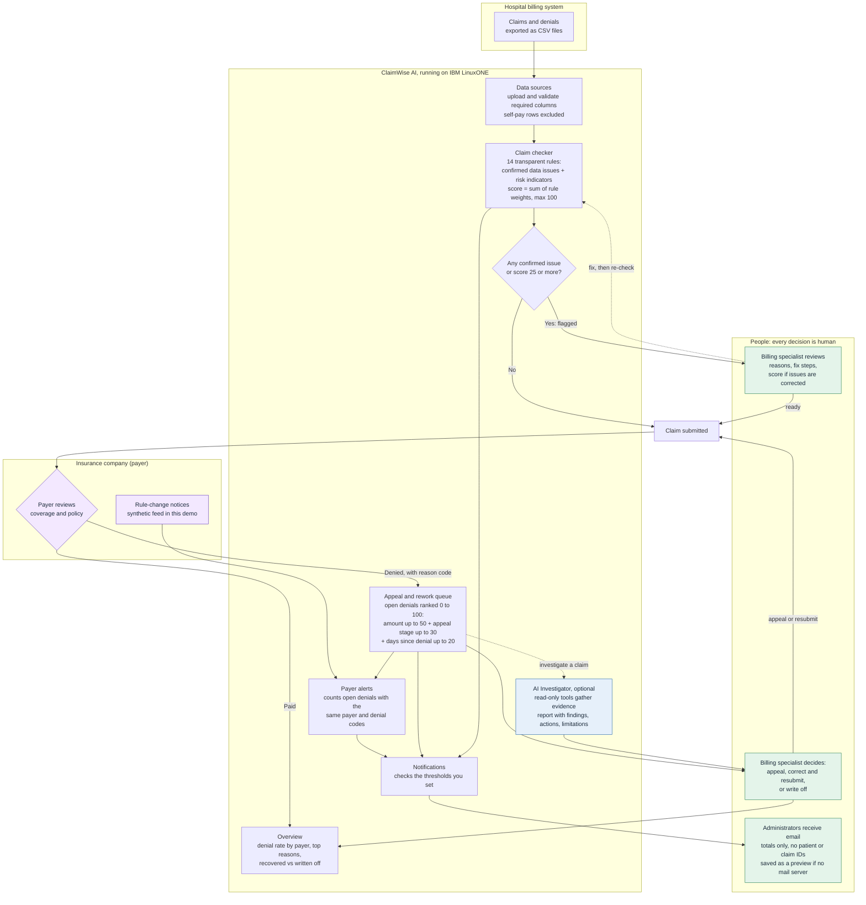

# ClaimWise AI

ClaimWise AI is a claims review assistant for hospital billing teams, built for the IBM Z Datathon at UTD AI Biz Club. It helps a billing specialist decide which denied or flagged claims to look at first, what the likely problem is, and what steps to take next. It runs on IBM LinuxONE (s390x) as well as Mac and x86 Linux, uses no compiled ML packages, and degrades gracefully when optional services (email, OpenAI API) are not configured.

**[Proof it runs on IBM LinuxONE (s390x)](docs/PROOF.md)**

> **Decision support only.** Results require human review and are not a substitute for payer policy verification. A flag is not a determination that a claim will be denied or paid. "Billed value requiring review" is an estimate, not a guaranteed financial loss.

---

## Features

The dashboard is a single-page Dash app with a **collapsible sidebar** (260 px expanded, 72 px collapsed, state saved to localStorage) and a **light/dark theme toggle** (preference saved to localStorage). There are eight pages:

| Page | What it shows | Data | Method |
|---|---|---|---|
| **Overview** | Denied dollars by stage (donut), top denial reasons by dollars (bar), denial rate by payer vs overall average (bar), denied dollars by month | Datathon claims and denials CSVs | Descriptive statistics |
| **Payer alerts** | Payer rule-update feed: status (In effect / Upcoming), how many open denials share the same payer and denial codes, simulated new-update workflow | `data/payer_rule_updates.csv` (synthetic) + real denial data | Counts of matching payer and denial codes |
| **Appeal queue** | Open denied claims ranked 0–100 for follow-up priority. Click a row for the score breakdown and recommended next step. Filter by payer, priority level, and denial code. | Datathon denials file | Documented priority score (see Scoring reference) |
| **Claim checker** | Missing or inconsistent fields and risk indicators across all claims. Click a row for the rule breakdown and fix steps. Filter by risk level, payer, rule, and free-text search. | Loaded claims file or built-in synthetic demo set | 14 transparent rules with documented weights (see Scoring reference) |
| **AI Investigator** | On-demand AI investigation of a single claim: four read-only tools gather evidence; an LLM produces a structured report with findings, recommended actions, and limitations. | Loaded claims and denials | OpenAI API (optional — app works without it; see AI Investigator section) |
| **Data sources** | Upload and validate replacement claims and denials CSVs. Required columns are checked; self-pay rows are excluded automatically. Restore the built-in demo data at any time. | User-supplied CSVs | Schema validation via `src/claims_processor.py` |
| **Notifications** | Configure per-event thresholds (high-priority open denials, overall denial rate, unworked denials, claims needing review). Preview the email. Send via SMTP or save as a `.eml` file. | Computed from loaded data | Thresholds you set |
| **How it works** | Every rule, weight, scoring formula, and limitation. Collapsible sections for the claim checker, appeal queue, AI Investigator, and general limitations. | — | — |

---

## How ClaimWise fits into the claim lifecycle



**Reading the diagram**

- ClaimWise works in two places: **before submission** (the claim checker catches data issues) and **after denial** (the appeal queue and AI Investigator). It never submits, approves, or denies a claim.
- Risk indicators are patterns associated with denials. They are **not predictions** that a specific claim will be denied.
- The 14 rules, the 25-point review threshold, and the 50/30/20 priority weights are our own design choices (see Scoring reference). They are not from an industry standard, a payer policy, or a validated model.
- Payer rule-change notices are a synthetic feed included for demonstration. In production this table would be fed from real payer bulletins.
- Emails contain totals only — no patient names, patient IDs, or claim IDs. If no mail server is configured, "Send" saves a preview `.eml` file to `output/outbox/` instead.

---

## AI Investigator

The AI Investigator page runs a bounded investigation on a single claim using four **read-only tools**:

| Tool | What it reads |
|---|---|
| `get_claim_details` | Permitted billing fields (no patient identifiers) |
| `get_denial_history` | Denial record for this claim, if one exists |
| `get_payer_rules` | Historical denial rate and top denial reasons for the payer |
| `get_similar_claims` | Billed amount compared with same-payer records (descriptive, not clinically matched) |

The LLM calls tools in up to five rounds, then returns a structured Markdown report with four headings: **Summary**, **Key findings** (each citing the tool), **Recommended actions** (specific, human-verifiable steps), and **Limitations**. The report always states that this is a risk indicator tool, not a denial prediction.

**What the AI Investigator does not do:**

- It does not predict whether a claim will be denied or paid.
- It does not invent eligibility, authorization, payer policy, clinical necessity, or corrections.
- It does not use the claim's known historical outcome to infer what was knowable before submission.
- Every finding requires human review before acting.

**Clarification on "no machine learning":** The claim checker and appeal queue use no ML — scores are computed from explicit rules and weights. The AI Investigator uses an LLM to produce readable summaries of tool outputs. It is an optional, bounded investigative aid, not a scoring or prediction component.

### Setting the API key safely

The Investigator requires an OpenAI API key. Set it in your shell — **never commit it to a file**:

```bash
read -s OPENAI_API_KEY && export OPENAI_API_KEY
```

Then start the app in the same shell session. Without the key the app runs normally and shows "AI investigator unavailable" on that page. The model can be overridden:

```bash
export COUVERTE_AGENT_MODEL=gpt-4o-mini   # default: gpt-4.1-mini
```

**On IBM LinuxONE (s390x):** do **not** install the `openai` package. It pulls in packages that conflict with Ubuntu's system site-packages and breaks the AI Investigator instead of enabling it. The investigator includes a `requests`-based fallback that calls the OpenAI REST API directly — no `openai` package required. Set `OPENAI_API_KEY` as above and the fallback is used automatically.

---

## Run it

### Mac or x86 Linux (Streamlit or Dash)

```bash
python3 -m venv .venv
source .venv/bin/activate
pip install --upgrade pip
pip install -r requirements.txt

python -m pytest -q           # 102 tests pass
streamlit run app.py          # Streamlit dashboard  →  http://localhost:8501
python app_dash.py            # Dash dashboard       →  http://localhost:8050
```

Python 3.9+ is required. Put `claims_and_billing.csv` and `denials.csv` in `data/` (they are large and not committed to this repo).

### IBM LinuxONE / s390x (Dash only)

Streamlit cannot install on s390x — it requires `pyarrow`, which has no s390x build. Use the Dash dashboard instead; the engine (`src/`) is identical.

```bash
sudo apt install -y python3-venv python3-pip python3-pandas python3-numpy python3-pytest \
  python3-markupsafe python3-jinja2 python3-jsonschema

python3 -m venv --system-site-packages .venv
source .venv/bin/activate
pip install -r requirements-server.txt

python -m pytest -q                        # 102 tests pass

tmux new -s claimwise
python app_dash.py --port 8050             # listens on 127.0.0.1:8050
# Ctrl-B D  to detach from tmux
```

From your own computer, open an SSH tunnel and browse to `http://localhost:8050`:

```bash
ssh -L 8050:localhost:8050 -i <key.pem> linux1@<server-ip>
```

### Email notifications (both versions)

Set these environment variables before starting the app. Without them, "Send" saves a preview `.eml` file to `output/outbox/` and nothing is transmitted.

```bash
export CLAIMWISE_SMTP_HOST=smtp.example.org
export CLAIMWISE_SMTP_PORT=587
export CLAIMWISE_SMTP_USER=your-account
export CLAIMWISE_SMTP_PASSWORD=your-password
export CLAIMWISE_FROM=claimwise@example.org
```

**Never commit credentials to a file.**

---

## Be clear about what is real and what is not

- **Real (as supplied by the datathon):** `data/claims_and_billing.csv` and `data/denials.csv`. All counts and dollar figures on the Overview and Appeal queue pages come from them.
- **Synthetic and labeled:** `data/sample_claims.csv` (demo claims with deliberate defects for the Claim checker demo mode) and `data/payer_rule_updates.csv` (illustrative payer rule updates for the Payer alerts page).
- **Not real-time, not a live integration:** payer alerts are read from a local file. You can simulate a new update arriving in the app. In production this table would be fed from real payer bulletins.
- **Scoring numbers are our own design choices:** the risk levels (Clean = 0, Low = 1–24, Medium = 25–49, High = 50–100), the review threshold (25), every rule weight, and the appeal-priority weights come from our team's judgment. They are not from an industry standard, a payer policy, or a validated model, and are not validated against real outcomes. A hospital would tune these with its own billing staff and data.

Two labels are always kept separate:

- **Confirmed data issue** — a deterministic fact visible in the record (e.g., a missing patient ID). Can be corrected.
- **Risk indicator** — a pattern associated with denials. Not a prediction. Requires human judgment to assess.

---

## Scoring reference

### Claim checker

Score = sum of the weights of all rules that fire, capped at 100. A claim needs review if it has **any confirmed issue** or a score of **25 or more**.

| Rule | Kind | Weight |
|---|---|---|
| Missing claim ID | Confirmed | 40 |
| Invalid billed amount | Confirmed | 40 |
| Missing insurance provider | Confirmed | 35 |
| Duplicate claim ID | Confirmed | 35 |
| Missing patient ID | Confirmed | 30 |
| Paid amount exceeds billed amount | Confirmed | 30 |
| Missing or unreadable billing date | Confirmed | 25 |
| Billing date in the future | Confirmed | 25 |
| Possible duplicate submission | Indicator | 25 |
| Missing encounter ID | Confirmed | 20 |
| Status is Paid but no payment recorded | Confirmed | 20 |
| Status is Denied but a payment is recorded | Confirmed | 20 |
| Denied with no denial reason | Confirmed | 15 |
| High billed amount (over $10,000) | Indicator | 10 |

"Score if confirmed issues are corrected" = sum of the indicator weights that remain after fixing every confirmed issue, capped at 100.

### Appeal queue (open denials only)

Priority score (0–100) = **amount points** + **status points** + **age points**. Closed denials score 0.

- **Amount points:** `min(denied_amount / $5,000, 1) × 50` — max 50 points
- **Status points:** No appeal filed = 30 · Appeal pending = 20 · Status unclear = 10 — max 30 points
- **Age points:** `min(days_since_denial / 90, 1) × 20` — max 20 points

Payer appeal deadlines differ; age is only a rough urgency signal, not a deadline tracker.

---

## Project layout

```
app.py                         Streamlit dashboard (Mac / x86 Linux)
app_dash.py                    Dash dashboard (also runs on IBM LinuxONE / s390x)
requirements.txt               All dependencies for Mac / x86 Linux
requirements-server.txt        Dash-only dependencies for IBM LinuxONE / s390x
run_pipeline.py                Command-line pipeline: validate, summarise, export CSVs

assets/
  style.css                    Dash dashboard styles (light + dark theme design tokens)
  favicon.png                  Browser tab icon
  icons/                       CSS mask icon SVG files (12 files, served by Dash)

src/
  agent.py                     AI Investigator: bounded OpenAI tool-calling loop
  claims_processor.py          Load, validate, clean, and merge claims and denials
  risk_engine.py               14-rule claim checker: rules, weights, scores, breakdowns
  appeal_queue.py              Denied-claim priority score and next-step guidance
  financial_analytics.py       Totals, denial statistics, billed value requiring review
  payer_alerts.py              Payer update feed and impact on open denials
  notifications.py             Alert events, email builder and sender
  plotly_charts.py             Plotly charts for the Dash dashboard (s390x-safe: plain Python lists)
  charts.py                    Altair charts for the Streamlit dashboard

data/
  sample_claims.csv            Synthetic demo claims (deliberate defects for Claim checker demo)
  payer_rule_updates.csv       Synthetic payer rule updates

.streamlit/config.toml         Streamlit theme

tests/                         102 pytest unit tests
```

---

## Limitations

- Rules are generic examples, not any specific payer's actual policy.
- The datathon data is synthetic; all numbers describe the loaded dataset and are not forecasts.
- Next-step guidance is general and must be verified against the payer's actual remittance advice and policy before acting.
- The AI Investigator calls the OpenAI API with claim-level billing data (no patient identifiers). Do not use it with real patient data unless you have an approved privacy arrangement in place.
- Reviewer status (Open / In review / Resolved) is stored per browser session only.
- The payer alert feed is a static local file in this demo, not a live integration with payer systems.
