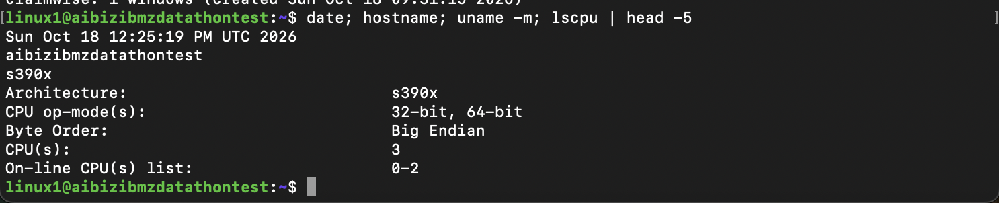
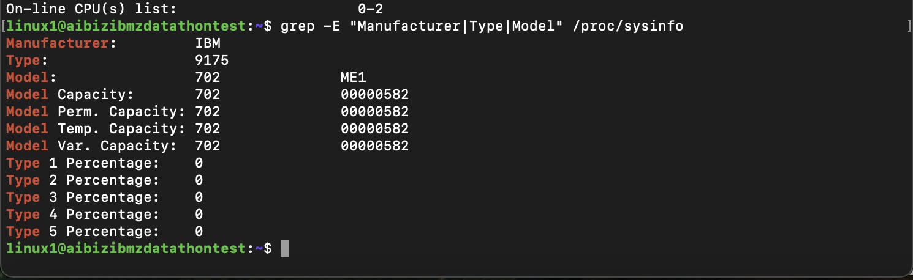
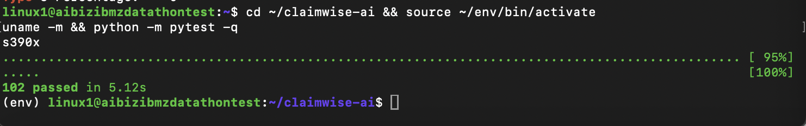
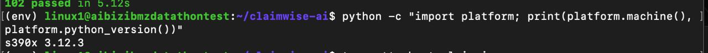
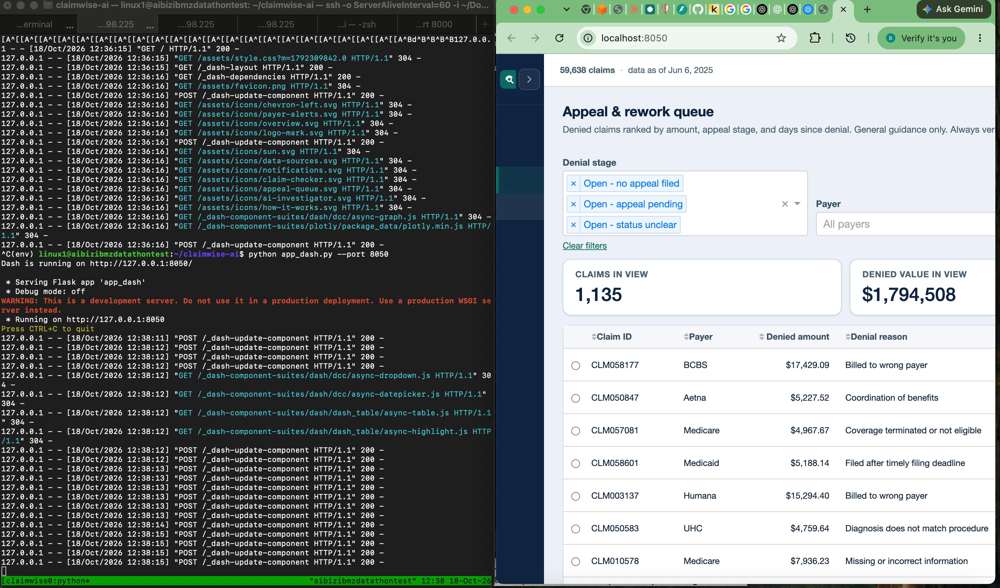

# ClaimWise AI running on IBM LinuxONE (s390x)

These screenshots were taken on 18 October 2026 on our IBM LinuxONE Community Cloud
server (`aibizibmzdatathontest`). They show that ClaimWise AI, its tests and its
dashboard run natively on IBM Z.

## 1. The server is IBM Z (s390x architecture)

`uname -m` and `lscpu` report the **s390x** architecture used by IBM Z and LinuxONE.

## 2. The hardware is made by IBM

`/proc/sysinfo` lists **IBM** as the manufacturer, machine type **9175**.

## 3. All automated tests pass natively on IBM Z

The full ClaimWise test suite (**102 tests**) passes on the s390x server.

## 4. Python runs natively on s390x

Python itself reports the **s390x** machine type (Python 3.12.3).

## 5. The live app is served by the LinuxONE server

Left: the ClaimWise Dash server running in tmux on `aibizibmzdatathontest`.
Right: the dashboard in the browser through an SSH tunnel. Each click in the
browser appears instantly as a request in the server log.

---

The app listens only on the server's localhost and is reached through an SSH tunnel,
so it is not exposed to the public internet. Data is synthetic demo data.
